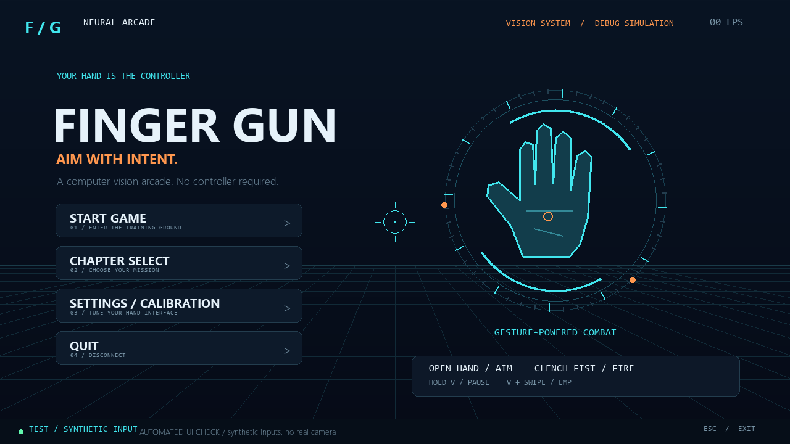
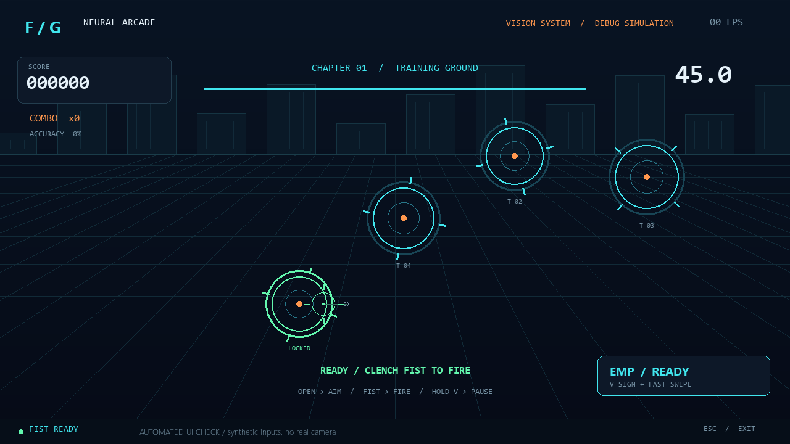
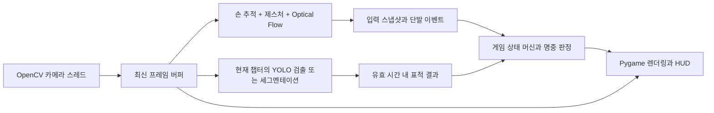

# Finger Gun FPS — Neural Arcade

**웹캠으로 손을 추적해 메뉴부터 조준·발사·재도전까지 조작하는 컴퓨터비전 아케이드 게임입니다.** 대학 컴퓨터비전 과제로, Hand Landmark Detection, Object Detection, Optical Flow, Instance Segmentation을 서로 다른 게임 기능에 연결했습니다.

Python과 Pygame으로 만든 2D FPS 스타일 인터페이스 위에 OpenCV 카메라 영상과 실제 사전학습 모델의 결과를 합성합니다. 3D 엔진이나 별도의 모델 학습 없이 CPU에서 실행하도록 구성했습니다.





위 이미지는 **합성 입력으로 렌더링한 UI 화면**입니다. 실제 카메라 인식 결과나 모델 정확도를 나타내는 자료는 아닙니다.

## 게임 구성

| 챕터 | 플레이 내용 | 실제 명중 판정 |
|---|---|---|
| **1 — Training Ground** | 움직이는 가상 드론 4개를 맞히며 조준·발사·콤보를 연습 | 원형 표적 내부 |
| **2 — Real World Hunt** | 웹캠에 보이는 생활 물체를 YOLO11n으로 검출해 표적으로 사용 | 검출 바운딩 박스 내부 |
| **3 — Precision Strike** | YOLO11n-seg의 물체 마스크와 윤곽을 표시하고 정밀 타격 | 실제 마스크의 픽셀 내부 |

- 기본 라운드는 **45초**이며 점수·남은 시간·명중률·챕터·콤보를 표시합니다.
- 첫 명중은 100점, 연속 명중마다 20점씩 증가해 최대 200점입니다. 빗나가면 콤보가 초기화됩니다.
- V 손모양으로 스와이프하면 **EMP 광역 공격**이 발동합니다. 표적당 40점, 재사용 대기시간 5초이며 총알 명중률에는 포함하지 않습니다.
- **300점 이상으로 라운드를 마치면 다음 챕터가 해제**됩니다. 결과 화면에서 다음 챕터·재도전·메인 메뉴를 선택할 수 있습니다.
- 실제 물체는 명중 후 2초간 다시 득점할 수 없고, 가상 드론은 새로 생성됩니다.
- 챕터 해제·최고 점수·조준 보정 범위는 실행 중 생성되는 `data/profile.json`에 저장됩니다.

메인 메뉴, 챕터 선택, 설정/보정, 플레이, 일시정지, 결과 화면을 별도의 상태로 관리합니다. 네온 조준점, 표적 잠금 표시, 명중/빗나감 효과, 파티클, 화면 전환, 합성 효과음을 제공합니다. 그래픽과 소리는 코드로 생성하므로 외부 게임 에셋이 필요하지 않습니다.

## 설치 및 실행

### 실행 환경

검증한 환경은 **Windows 11 / Python 3.12.3 / CPU 추론**입니다. 웹캠이 필요하며 NVIDIA GPU는 필요하지 않습니다. 다른 운영체제와 Python 버전은 직접 검증하지 않았습니다.

저장소에는 소스·테스트·설치 도구·문서만 포함합니다. **가상환경과 모델 가중치는 포함하지 않으므로 최초 실행 전에 아래 설치를 진행해야 합니다.**

### Windows PowerShell

```powershell
git clone https://github.com/singolbang/Hand_FPS.git
cd Hand_FPS

python -m venv .venv
.\.venv\Scripts\python.exe -m pip install --upgrade pip

# CPU용 PyTorch를 먼저 설치합니다.
.\.venv\Scripts\python.exe -m pip install torch==2.7.0 torchvision==0.22.0 --index-url https://download.pytorch.org/whl/cpu
.\.venv\Scripts\python.exe -m pip install -r requirements.txt

# 공식 배포처에서 사전학습 모델 3개를 다운로드합니다.
.\.venv\Scripts\python.exe tools/download_models.py

# 게임 진입점
.\.venv\Scripts\python.exe main.py
```

실행할 파일은 **`main.py`**입니다. 위 명령은 가상환경 활성화를 요구하지 않으므로 PowerShell 실행 정책을 바꿀 필요가 없습니다. 이후에는 프로젝트 폴더에서 마지막 실행 명령만 사용하면 됩니다.

`requirements.txt`는 검증한 직접 의존성 버전을 고정합니다. MediaPipe는 `opencv-contrib-python`, Ultralytics는 `opencv-python`을 요구하므로 두 패키지를 같은 **4.10.0.84**로 맞췄습니다. 두 배포판이 `cv2` 이름을 공유하므로 전용 가상환경을 사용하고 한쪽 버전만 별도로 변경하지 않는 구성을 전제로 합니다. PyTorch 패키지의 다운로드 용량은 아래 모델 가중치보다 큽니다.

### 카메라 없이 화면 확인

```powershell
.\.venv\Scripts\python.exe main.py --demo
```

`--demo`는 **마우스·키보드 디버그 모드**이며 화면에도 DEMO로 표시합니다. 실제 비전 모델을 실행하지 않고, Chapter 2/3은 사용할 수 없습니다. 모델 가중치 없이 Chapter 1의 게임 흐름과 UI를 확인할 수 있습니다.

## 조작법

### 처음 플레이할 때

1. 카메라를 향해 손바닥이 보이도록 손을 들고, 메뉴에서는 **검지로 버튼을 가리킨 채 1.5초** 머무릅니다.
2. START GAME으로 진입한 뒤 **손가락을 쭉 펴고** 손 전체를 움직여 조준합니다. 게임의 조준점은 손바닥 중심을 따라갑니다.
3. 표적 근처에서 초록색 잠금 표시와 **FIST READY**를 확인한 뒤 **주먹을 쥐면 한 발** 발사됩니다.
4. **다시 손을 펴면 다음 발을 준비**합니다. 주먹을 계속 쥐고 있어도 연속 발사되지 않습니다.

발사는 엄지와 검지를 맞대거나 엄지만 접는 방식이 아닙니다. **검지·중지·약지·소지 네 손가락의 펼침/접힘**을 구분하며, 엄지 위치는 게임 발사 판정에 사용하지 않습니다.

| 기능 | 손동작 |
|---|---|
| 메뉴 커서 이동 | 검지 끝의 위치로 이동 |
| 메뉴 선택 | 검지로 가리키고 1.5초 머무르기. 검지를 편 상태의 엄지 접기 선택도 지원 |
| 게임 조준·발사 | 손 펴기 → 손바닥 중심으로 조준 → 주먹 쥐기 → 다시 손 펴기 |
| 일시정지 | 검지·중지를 펴고 약지·소지를 접은 **V 손모양을 0.7초 유지** |
| 재개·재시작 | 일시정지 메뉴에서 검지로 해당 버튼 선택 |
| 뒤로 가기 | BACK/MAIN MENU 버튼 선택. 챕터·설정·결과 화면에서는 V 유지도 가능 |
| 챕터 카드 탐색 | V를 잠깐 유지해 `V / COMMAND` 표시 후 좌우 스와이프, 원하는 카드는 검지로 선택 |
| EMP 특수 공격 | 게임 중 V를 잠깐 유지한 뒤 빠르게 좌우 스와이프 |
| 추적이 끊긴 경우 | 입력이 차단되고, 1.2초 이상 손이 없으면 자동 일시정지 |

V 스와이프 후에는 손을 펴서 조준으로 돌아갑니다. V를 그대로 0.7초 더 유지하면 일시정지/뒤로 가기가 실행됩니다. 손을 편 채 조준하는 동작은 일시정지나 EMP를 실행하지 않습니다.

메뉴를 한 번 머무르기로 선택한 뒤에는 커서를 약 55px 옮기거나 손가락을 접었다가 다시 가리켜야 머무르기 선택이 재활성화됩니다. 화면 전환 직후 겹치는 버튼이 연속 선택되는 것을 방지합니다.

### 조준 보조와 민감도

- 표적 가까이 조준하면 실제 타격 가능한 지점으로 조준점이 붙고 초록색으로 표시됩니다. Chapter 1/2는 경계에서 64px, Chapter 3은 **실제 마스크 픽셀에서 20px** 이내를 보조합니다. 수치는 1280×720 논리 화면 기준입니다.
- 명중 판정에는 화면에 표시되는 보정된 조준점을 사용합니다. Chapter 3에서 박스 안이라는 이유만으로 명중 처리하지 않습니다.
- 발사에는 **손가락을 접기 직전, 마지막으로 손을 완전히 폈을 때의 조준 위치**를 사용해 주먹을 쥐면서 생기는 흔들림을 줄입니다.
- Settings의 **AIM STABILITY / HIGH**가 기본값입니다. HIGH는 0.15초, NORMAL은 0.075초 평활화를 적용합니다. 6px 이하의 미세 떨림을 무시하고 순간 커서 이동 속도를 제한합니다.
- **CALIBRATE AIM RANGE**에서 펼친 손바닥 중심을 편하게 닿는 왼쪽 위, 오른쪽 아래에 차례로 놓고 각각 1.3초 유지합니다. 단계마다 2초 준비시간이 있습니다. RESET RANGE로 기본 범위를 복구할 수 있습니다.

일반적인 게임 흐름은 손으로 조작합니다. **Esc**는 긴급 종료, **F1**은 관절·인식 제스처·성능 디버그 표시, **F11**은 전체 화면 전환입니다. `--demo`에서는 마우스 이동/클릭, Space·Enter 발사/선택, P 일시정지, E EMP, 방향키 챕터 탐색을 사용합니다.

## 사용한 프레임워크와 라이브러리

| 기술 | 검증한 버전 | 프로젝트 내 역할 |
|---|---|---|
| Python | 3.12.3 | 게임 로직, 상태 머신, 비전 파이프라인 |
| [Pygame Community Edition](https://pyga.me/docs/) | 2.5.7 | 윈도우·입력 이벤트·2D 렌더링·HUD·파티클·오디오 |
| OpenCV / OpenCV Contrib | 4.10.0.84 | 웹캠, 영상 변환, LK Optical Flow, 마스크 윤곽 처리 |
| [MediaPipe](https://developers.google.com/edge/mediapipe/solutions/vision/hand_landmarker/python) | 0.10.32 | 사전학습 Hand Landmarker로 손 관절 추출 |
| [Ultralytics](https://docs.ultralytics.com/models/yolo11/) | 8.3.59 | YOLO11n 객체 검출 및 YOLO11n-seg 인스턴스 세그멘테이션 |
| PyTorch / torchvision | 2.7.0 / 0.22.0 | YOLO 모델의 CPU 추론 런타임 |
| NumPy | 1.26.4 | 랜드마크 기하 계산, 영상 배열, 마스크·효과음 처리 |

`pygame-ce`의 Python import 이름은 `pygame`입니다. 별도의 `pygame` 배포판을 추가 설치할 필요가 없습니다.

## 컴퓨터비전 구현 상세

### 1. Hand Landmark Detection — 조준과 제스처

**구현:** [`hand_tracker.py`](hand_tracker.py)

MediaPipe Tasks의 `HandLandmarker`를 **VIDEO 모드**로 한 번 생성하고, 증가하는 타임스탬프와 RGB 프레임을 전달합니다. 한 손의 21개 랜드마크를 추출하며 손 검출·존재·추적 신뢰도 기준은 0.55입니다. 별도의 제스처 분류 신경망을 학습하지 않고 랜드마크의 기하 관계로 동작을 분류합니다.

- 영상 종횡비를 반영한 좌표에서 손가락 관절 각도와 손목까지의 거리 비율을 함께 계산합니다.
- 손가락이 펴졌다는 판정은 관절 각도 150° 초과와 거리 비율 1.12 초과를 함께 요구합니다. 접힘은 130° 미만과 거리 비율 1.1 미만으로 별도 확인합니다. 단순히 펼침 조건을 만족하지 않는 손을 모두 주먹으로 처리하지 않습니다.
- 검지·중지·약지·소지 모두 펼쳐진 손을 **0.10초** 관측하면 발사 준비, 모두 접힌 주먹을 **0.04초** 관측하면 발사 이벤트를 한 번 생성합니다. 발사 간 최소 간격은 **0.28초**이고, 다음 발에는 다시 손을 펴야 합니다.
- 손을 접는 중간 자세는 허용합니다. V가 **0.18초** 유지되면 명령 자세로 확정하고 발사 준비를 해제해 일시정지·스와이프와 발사가 겹치지 않게 합니다.
- 메뉴는 검지 끝, 게임/보정은 손목과 네 손가락 뿌리의 중심을 사용합니다. 조준 범위 정규화, 시간 기반 평활화, 데드존, 속도 제한을 적용합니다.
- 손 추적 실패, 0.30초를 넘는 입력 간격, 게임/메뉴 모드 변경 시 발사 준비를 초기화합니다. 주먹 상태로 처음 나타나거나 추적이 복구됐다는 이유만으로 발사하지 않습니다.

손 모양에 따른 발사·V 명령은 랜드마크 기반입니다. 다음의 영상 움직임 분석과 구분됩니다.

### 2. Object Detection — 실제 물체를 표적으로 변환

**구현:** [`object_detector.py`](object_detector.py), Chapter 2

사전학습 **YOLO11n**을 입력 크기 320, 신뢰도 0.4, CPU 모드로 실행합니다. 결과의 클래스 이름·신뢰도·정규화된 `xyxy` 바운딩 박스를 게임의 `Target`으로 변환합니다. 화면에 검출 박스를 표시하고 조준점이 박스 내부에 있는지로 명중을 판정합니다.

컵, 병, 책, 휴대폰, 노트북, 키보드, 의자, 가방 등 제한된 COCO 생활 물체 클래스를 사용합니다. 정확한 목록은 `TARGET_CLASSES`에 있으며 사람 클래스는 제외합니다. 임의의 모든 물체를 인식하는 모델은 아닙니다.

같은 클래스의 이전 검출과 **IoU 0.3 초과**로 일대일 매칭해 ID를 유지합니다. 이 ID는 명중 후 재득점 대기시간 등에 사용합니다. 가림이나 급격한 이동을 견디는 전문 다중 객체 추적기는 아닙니다.

### 3. Optical Flow — V 스와이프로 EMP와 챕터 탐색

**구현:** [`optical_flow.py`](optical_flow.py), [`vision.py`](vision.py)

실제 연속 영상에 [Lucas–Kanade Sparse Optical Flow](https://docs.opencv.org/4.x/d4/dee/tutorial_optical_flow.html)를 적용합니다.

1. 프레임을 폭 320px의 grayscale 영상으로 축소하고, 손 랜드마크의 경계로 관심 영역(ROI)을 정합니다.
2. `goodFeaturesToTrack`으로 이전 프레임의 손 영역에서 최대 65개 특징점을 찾습니다.
3. `calcOpticalFlowPyrLK`로 다음 프레임까지 특징점을 추적하고, 역방향 추적 오차와 LK 오차가 큰 점을 제외합니다.
4. 손 영역의 이동 벡터 중앙값에서 주변 배경 이동 중앙값을 빼 카메라 흔들림의 영향을 줄입니다.
5. 유효 특징점 수, 방향 일관성, 수평 이동량·속도 기준을 만족하면 좌우 스와이프 이벤트를 생성합니다.
6. **V 명령 자세가 확인된 경우에만** 게임에서는 EMP, 챕터 선택에서는 인접 카드 강조로 연결합니다.

랜드마크는 ROI와 명령 허용 여부에 사용하며, 이동 방향·속도는 **영상의 특징점 흐름**에서 계산합니다. 손 관절 좌표 차이를 Optical Flow로 대체하지 않습니다. 텍스처나 조명이 부족하면 이벤트를 만들지 못할 수 있으며, 다른 알고리즘으로 자동 대체하지 않습니다.

### 4. Instance Segmentation — 실제 윤곽과 픽셀 명중 판정

**구현:** [`segmenter.py`](segmenter.py), [`game_state.py`](game_state.py), [`renderer.py`](renderer.py), Chapter 3

사전학습 **YOLO11n-seg**를 사용해 물체별 `masks.data`를 얻습니다. `retina_masks=True`로 추론하고, 필요한 경우 최근접 보간으로 원본 프레임 해상도에 맞춘 뒤 0.5 기준의 boolean 마스크로 변환합니다.

마스크 영역에 색을 합성하고 OpenCV `findContours`/`drawContours`로 실제 윤곽을 강조합니다. 명중 시 해당 영역이 점멸합니다. 정규화된 조준 좌표를 마스크 픽셀로 변환해 **그 픽셀이 물체 영역인지** 검사하므로 바운딩 박스 안쪽의 빈 공간은 빗나감입니다. 조준 보조도 실제 마스크의 픽셀을 찾습니다. 마스크가 없는 결과를 박스로 채워 세그멘테이션처럼 사용하지 않습니다.

## 구조와 성능 설계



- **카메라, 손 추적/Flow, 객체 추론을 별도 스레드**로 처리하고 메인 스레드는 화면을 그립니다. 처리할 영상이 밀리지 않도록 최신 프레임만 소비합니다.
- 렌더링은 최대 60FPS, 카메라는 640×480/30FPS를 요청합니다. 손 처리는 최대 30Hz, YOLO는 기본 4Hz입니다. 실제 속도는 하드웨어에 따라 달라집니다.
- 손 모델은 한 번 로드합니다. 검출·세그멘테이션 모델도 최초 필요 시 로드해 재사용하며, 무거운 객체 추론은 **현재 챕터의 모델 하나만** 실행합니다. CPU 추론 스레드는 2개로 제한합니다.
- 0.30초 이상 오래된 손 입력과 0.65초 이상 오래된 객체 결과는 사용하지 않습니다. 챕터 변경 전의 결과·이벤트도 폐기합니다.
- 발사 이벤트에 조준 좌표를 함께 전달하고 한 번만 소비합니다. 손 입력 처리와 렌더링 주기가 달라도 같은 발사가 반복되지 않습니다.
- 카메라 초기화/모델 파일 오류를 화면에 표시하며 종료 시 worker, 카메라, MediaPipe, Pygame 리소스를 정리합니다. 카메라 영상은 로컬 메모리에서 처리하며 자동 저장·외부 전송하지 않습니다.

| 파일 | 역할 |
|---|---|
| `main.py` | 진입점, CLI, Pygame 메인 루프와 종료 처리 |
| `config.py` | 설정값, 챕터 정보, 진행도·보정 범위 저장 |
| `hand_tracker.py` | 손 추적, 기하 제스처, 발사 게이트, 커서 평활화 |
| `game_state.py` | 메뉴/플레이 상태, 조준 보조, 명중, 점수, 보정 |
| `renderer.py` | UI, 영상/마스크 합성, 파티클, 효과음 |
| `vision.py` | 카메라와 비전 worker, 최신 결과 및 이벤트 전달 |
| `object_detector.py` | YOLO 검출, 제한 클래스, IoU 기반 ID |
| `optical_flow.py` | 영상 특징점 추적과 스와이프 감지 |
| `segmenter.py` | YOLO 인스턴스 마스크 추론 및 변환 |
| `tools/` | 모델 다운로드, 환경/모델 진단, UI smoke 검사 |
| `tests/` | 제스처, 게임 흐름, 조준 보조, Flow, 비전 전달 회귀 테스트 |

### 실행 옵션

```powershell
# 카메라 선택 및 전체 화면
.\.venv\Scripts\python.exe main.py --camera 1 --fullscreen

# 느린 CPU에서 객체 추론 빈도 감소
.\.venv\Scripts\python.exe main.py --infer-hz 2 --mute

# 디버그 표시, 60초 라운드
.\.venv\Scripts\python.exe main.py --debug --duration 60
```

`--duration`은 5~180초, `--infer-hz`는 0.5~12Hz를 받습니다. GPU 실행 옵션은 구현하지 않았습니다.

## 사전학습 모델

| 로컬 경로 | 용도 | 공식 다운로드 |
|---|---|---|
| `models/hand_landmarker.task` | 모든 손동작 입력 | [Google, 약 7.8MB](https://storage.googleapis.com/mediapipe-models/hand_landmarker/hand_landmarker/float16/1/hand_landmarker.task) |
| `models/yolo11n.pt` | Chapter 2 검출 | [Ultralytics v8.3.0, 약 5.6MB](https://github.com/ultralytics/assets/releases/download/v8.3.0/yolo11n.pt) |
| `models/yolo11n-seg.pt` | Chapter 3 마스크 | [Ultralytics v8.3.0, 약 6MB](https://github.com/ultralytics/assets/releases/download/v8.3.0/yolo11n-seg.pt) |

모델 가중치는 합계 약 **19.6MB**이며 Git에 업로드하지 않습니다. `tools/download_models.py`가 공식 배포처에서 다운로드하고 기존 파일은 재사용합니다. 출처·크기·SHA256을 `models/manifest.json`에 기록하며, 이 해시는 로컬 파일 식별용이고 별도 서명 검증은 아닙니다. **게임 실행 중에는 모델을 자동 다운로드하지 않습니다.**

Chapter 1만 준비하려면 `.\.venv\Scripts\python.exe tools/download_models.py --hand`를 사용합니다. 오프라인 환경에서는 위 파일들을 다른 기기에서 받아 `models/`에 복사할 수 있습니다. 모델이 없으면 해당 기능을 사용할 수 없다는 안내가 표시됩니다.

사용한 프레임워크와 모델의 라이선스는 각 배포처를 따릅니다. 관련 원문은 [MediaPipe](https://github.com/google-ai-edge/mediapipe/blob/master/LICENSE), [Ultralytics](https://github.com/ultralytics/ultralytics/blob/v8.3.59/LICENSE), [Ultralytics 라이선스 안내](https://www.ultralytics.com/license)에서 확인할 수 있습니다.

## 테스트와 검증 범위

```powershell
# 모델 가중치나 카메라 없이 로직 테스트
.\.venv\Scripts\python.exe -m unittest discover -s tests -v

# 합성 입력으로 7개 UI 상태 렌더링 및 게임 흐름 검사
.\.venv\Scripts\python.exe tools/smoke_test.py

# 창을 열지 않는 데모 실행 확인
.\.venv\Scripts\python.exe main.py --demo --headless --frames 120

# 설치된 라이브러리 확인
.\.venv\Scripts\python.exe tools/check_environment.py

# 모델 준비 후: 실제 모델 추론 및 웹캠 검사
.\.venv\Scripts\python.exe tools/check_environment.py --models --camera 0
```

- **자동 테스트:** 46개 테스트로 손 펴기/주먹 발사, 재장전·쿨다운·추적 단절, V 명령 충돌 방지, 메뉴 선택, 점수·챕터 해제, 보정, 조준 보조, 실제 LK 알고리즘의 합성 영상 이동 검출, 마스크 안/밖 판정 등을 검사합니다.
- **UI smoke 검사:** 합성 랜드마크·표적·마스크로 상태 전환과 렌더링을 검사합니다. 사용자의 저장 데이터를 바꾸지 않으며 `artifacts/`에 화면을 생성합니다.
- **실제 모델 검사:** `--models`는 Ultralytics 공식 공개 버스 사진 약 140KB를 받아 검출과 세그멘테이션을 실행하고 마스크의 크기·내용·내부 판정을 확인합니다. 버스 클래스는 이 검사에만 허용합니다. 손 모델은 빈 프레임의 무검출 처리도 검사합니다.
- **실제 카메라 검사:** `--camera 0`은 5초 동안 카메라 프레임과 손 추적 상태를 확인하며 카메라 이미지를 저장하지 않습니다. 다른 앱이나 실행 중인 게임이 카메라를 점유하지 않은 상태에서 사용합니다.

개발 환경에서 자동 테스트, UI 검사, 실제 사전학습 모델 추론과 카메라 연결을 확인했습니다. 검증에 사용한 가상환경은 기존 CPU PyTorch 설치를 재사용했으며, 완전히 새 PC에서 모든 패키지를 다시 설치하는 과정은 직접 검증하지 않았습니다. **실제 사람이 최신 손동작으로 세 챕터를 처음부터 끝까지 플레이한 검증이나 정량적인 제스처 인식률 측정은 완료하지 않았습니다.** 합성 테스트와 실제 비전 추론 검사를 구분해 해석해야 합니다.

## 알려진 한계와 문제 해결

- **손이 잘 인식되지 않음:** 손바닥이 카메라를 향하고 네 손가락이 프레임 안에 보이도록 합니다. 옆으로 기울어진 손, 어두운 조명, 가림, 작은 손 영상에서는 펼침/주먹 구분이 불안정할 수 있습니다. 추적 복구 후에는 다시 손을 펴고 FIST READY를 확인합니다.
- **발사가 누락됨:** 매우 짧게 쥐었다가 바로 펴면 확인 시간이 부족할 수 있습니다. 엄지만 접지 말고 네 손가락을 분명히 접습니다. 여러 사람이나 여러 손을 동시에 조작하는 모드는 지원하지 않습니다.
- **너무 민감함:** Settings에서 HIGH를 사용하고 손바닥 기준으로 조준 범위를 다시 보정합니다. 기본 카메라 범위는 `(0.06, 0.04) ~ (0.94, 0.94)`입니다.
- **EMP가 잘 안 나감:** 밝은 곳에서 V를 잠깐 유지한 후 수평으로 스와이프합니다. 특징점이 적거나 모션 블러가 심하면 Optical Flow가 실패할 수 있습니다. 주변 물체 움직임에 의한 오검출도 완전히 제거하지는 못합니다.
- **실제 표적이 안 보임:** 컵·병·책 등 지원 클래스의 물체를 화면 중앙에 놓습니다. 학습 클래스 밖 물체나 작고 가려진 물체는 검출하지 못할 수 있습니다.
- **박스/마스크가 늦게 따라옴:** 추론은 기본 4Hz이며 프레임마다 갱신되지 않습니다. 고정된 물체로 시연하는 편이 안정적입니다. IoU ID는 가림이나 급격한 이동 후 바뀔 수 있어 동일 물체의 재득점 제한도 완벽하지 않습니다.
- **프레임률 저하:** 손 추적과 객체 추론이 CPU를 공유합니다. `--infer-hz 2`, 음소거, 디버그 표시 끄기를 사용합니다. 모델 최초 로딩은 일반 추론보다 오래 걸리며 특정 FPS를 보장하지 않습니다.
- **카메라가 열리지 않음:** Windows 카메라 권한과 다른 앱의 점유를 확인하고 `--camera 1`을 시도합니다. 카메라를 분리했다면 재연결 후 게임을 다시 실행합니다.
- **화면 비율:** 카메라 영상은 1280×720 게임 화면에 맞춰 늘립니다. 4:3 영상은 가로로 늘어날 수 있으나 박스·마스크·명중 판정은 같은 좌표계를 사용합니다. 실제 공간의 깊이, 총구 방향, 탄도는 계산하지 않습니다.
- **실행 환경:** 오디오 장치가 없어도 음소거로 실행합니다. 네이티브 카메라 드라이버가 종료 요청에 응답하지 않으면 대기 제한 후 경고를 남길 수 있습니다. MediaPipe의 일부 네이티브 경고와 실제 모델 로딩 실패는 구분해야 합니다.

## 저장소에 포함하지 않는 파일

`.gitignore`로 가상환경, 모델 가중치/매니페스트, 개인 진행도·보정값, 캐시, 진단 로그와 생성 결과물, 로컬 개발 메모를 제외합니다. README용 UI 이미지 두 장만 `docs/images/`에 포함합니다. 필요한 모델과 검사 결과는 문서의 도구로 생성할 수 있습니다.
